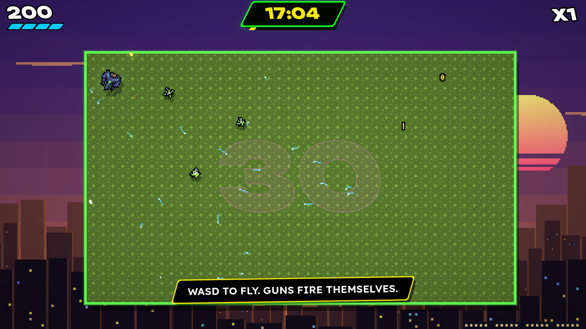

# SUPER SMASK ZERO

Smask everything. Count to zero.

An arcade shooter you can't aim. Your guns fire themselves. You fly, you drift, you
charge, you SMASK. Clear eight hours, from 17:00 to midnight. Pixel-art game, full-HD
UI with real bloom. Made in Godot 4.7.2 for keyboard, mouse, pad and touch, on Windows
and Linux. Needs Vulkan or D3D12.

Started in 2016 as PostWork, an unfinished libGDX game. The Java is in this repo's
history, up to commit `a340553`. Tune the numbers in `src/data/balance.gd`.





## From the original

- The name, and the logo's rock and breathing
- The flight: same top speed, more grip
- Auto-firing homing missiles, eight salvos a second
- Hold to stop firing and brake (now it charges the SMASK)
- The ship, froglet, starball, yellowcrab and floor tile (`art/original`)
- The floor's endlessly cycling colour

The floor hangs over a pixel-art city that goes from sunset to midnight as you play.

## Running

```sh
../Godot/Godot_v4.7.2-stable_linux.x86_64 --path .
```

Or open the folder in the Godot 4.7 editor and press Play.

## Playing

| | Keyboard | Pad | Mouse | Finger |
|---|---|---|---|---|
| Fly | WASD or arrows | left stick, right trigger | point, hold right click | left thumb |
| SMASK (hold, release) | Space, Shift, J or Z | A, X, bumpers, left trigger | left click | right thumb |
| Pause | Esc or P | Start | Esc | top right corner |

- **Auto-fire:** the faster you fly, the harder missiles hit.
- **SMASK:** hold to charge, release to ram. Longer hits harder and flies further. Safe while gold, and the ring round the
  ship shows how long. Kills reset it. Walls make a shockwave. Only a SMASK cracks shells.
- **Hours:** the floor shows what's left. Hit zero, get +1 hull, pick a perk.

| | | |
|---|---|---|
| 17:00 | Clocking Out | froglets, crabs, your first hermit |
| 18:00 | The Car Park | starballs, a shoal of tadpoles |
| 19:00 | **The Commute** | a train: every carriage is a target, and then the engine |
| 20:00 | Leftovers | bumpers, frogspawn, squid |
| 21:00 | One More Episode | bumpers, urchins that go off when they die |
| 22:00 | **Reply All** | an envelope that splits, and the count goes *up* |
| 23:00 | Can't Sleep | the walls come in |
| 00:00 | **Overtime** | the clock: twelve numbers to shoot, lethal hands, then its face |

Win to unlock **Graveyard**: endless, and it keeps getting harder. **Easy Mode** in
Options gives +2 hull, but no high scores.

## Building

```sh
./build_game.sh
```

exports every preset in `export_presets.cfg` whose export template is installed
(Windows and Linux) into `builds/<preset>/`, with the engine's notices, the
credits and the font's licence beside the game. `./build_game.sh Linux` builds
just that, and `--zip` zips each. It uses the stock editor in `../Godot/`;
`GODOT=/path/to/godot` points it at another.

## Testing

The game can play itself. These are the options, after a `--`:

```sh
../Godot/Godot_v4.7.2-stable_linux.x86_64 --path . --audio-driver Dummy -- --screen=play --autoplay --no-save --seed=4 --speed=8
```

`--autoplay` flies the ship with the title's demo pilot and prints each hour's
time and score and how it ended; `--invincible` so it can't lose; `--hour=5`,
`--perks=twin,fuse` and `--mode=graveyard` start a run there; `--shots=4,9`
saves screenshots to `shots/`; `--show=perks`, `pause`, `over`, `smask` or `pickups` brings that up; `--input-test` plays through the title, the flying, the SMASK and the pause
menu with real input events and says what it saw. All of them are in `src/main.gd`.

The assets are made from the sources by `tools/make_sprites.py`,
`tools/make_font.py`, `tools/merge_font.py` and `tools/import_audio.py` (from `../Assets`).
