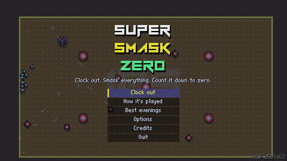
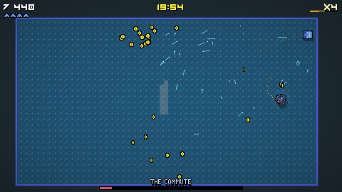
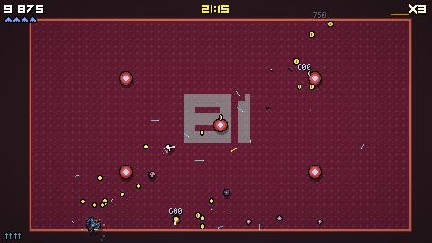
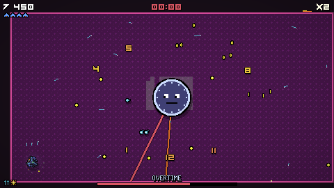

# SUPER SMASK ZERO

Clock out. Smask everything. Count it down to zero.

Super Smask Zero is an arcade shooter you can't aim, made in Godot 4.7.2. It's
17:00 and work's over. Your ship has a lot of momentum and very little grip,
its guns aim themselves at everything at once, and the number on the floor is
what's left of the hour. Get it to zero and the clock moves on. Get to midnight.
It plays with a keyboard, a mouse, a pad or a finger, on Windows, Linux and in a
browser.

It began as a libGDX game called PostWork, in 2016, built after work and never
finished: the Java is in this repository's history (up to commit `a340553`).
Every number worth tuning is in one place, `src/data/balance.gd`.






## What came from the original

- **The name and the logo:** its start screen said SUPER SMASK ZERO, in Vermin
  Vibes 1989, breathing and rocking two degrees either way. It still does.
- **The flight:** a quick turn to where the stick points (16 a second), a shove
  along wherever the ship's pointing, and drag, with the same top speed of about
  397 pixels a second. It has more grip than the original had (480 of thrust
  against 360), because its floors are a lot busier now.
- **The guns:** salvos of homing missiles eight times a second, that you don't
  aim, that swing wide and overshoot, and that die on the walls.
- **The charge:** holding the button stopped the guns and slowed the ship to the
  same crawl. In the original nothing came of it. Now it's the SMASK.
- **The art:** the ship and its four frames, the froglet, the starball, the
  yellowcrab and the floor tile, in `art/original`. Everything new is drawn in
  their palette (`tools/make_sprites.py`).
- **The floor:** its hue goes round for ever, as it did.

What's new is the game around it: the SMASK, the hours and the count, the
enemies past those three, the bosses, the perks, the score, the sound, the menus.

## Running

```sh
../Godot/Godot_v4.7.2-stable_linux.x86_64 --path .
```

Or open the folder in the Godot 4.7 editor and press Play.

## Playing

| | Keyboard | Pad | Mouse | Finger |
|---|---|---|---|---|
| Fly | WASD or arrows | left stick, right trigger | point, hold right click | left thumb |
| SMASK (hold, let go) | Space, Shift, J or Z | A, X, bumpers, left trigger | left click | right thumb |
| Pause | Esc or P | Start | Esc | top right corner |

**The guns aim themselves.** The faster you're flying, the harder they hit.

**The SMASK.** Hold it and the guns stop, the ship brakes and the world slows;
point yourself at something and let go. You go straight through whatever's there
and can't be hurt while you do. A kill with it means you can go again at once.
Into a wall, it's a shock wave. It's the only thing that cracks a hermit's shell.

**The hours.** Each is cleared by counting it down to zero, which is the number on
the floor. The clock on the HUD only moves on by killing things. After each hour
there's a coffee on the house (one hull back) and a choice of three perks.

| | | |
|---|---|---|
| 17:00 | Clocking Out | froglets, crabs, your first hermit |
| 18:00 | The Car Park | starballs, a shoal of tadpoles |
| 19:00 | **The Commute** | a train: every carriage is a target, and then the engine |
| 20:00 | Leftovers | bumpers, frogspawn, squid |
| 21:00 | One More Episode | bumpers, urchins that go off when they die |
| 22:00 | **Reply All** | an envelope that splits, and the count goes *up* |
| 23:00 | Can't Sleep | the walls come in |
| 00:00 | **Overtime** | the clock: twelve numbers to shoot, lethal hands, then its face |

Seeing midnight off opens the **Graveyard Shift**, which goes on past it, a little
worse each hour, until it gets you. Spare Hull in the options gives you two more
hull and takes you off the high score table.

## Building

```sh
./build_game.sh
```

exports every preset in `export_presets.cfg` whose export template is installed
(Windows, Linux and Web) into `builds/<preset>/`, with the engine's notices, the
credits and the font's licence beside the game. `./build_game.sh Web Linux` builds
just those, and `--zip` zips each. It uses the stock editor in `../Godot/`;
`GODOT=/path/to/godot` points it at another.

## Testing

The game can play itself. These are the options, after a `--`:

```sh
../Godot/Godot_v4.7.2-stable_linux.x86_64 --path . --audio-driver Dummy -- --screen=play --autoplay --no-save --seed=4 --speed=8
```

`--autoplay` flies the ship with the title's demo pilot and prints each hour's
time and score and how it ended; `--invincible` so it can't lose; `--hour=5`,
`--perks=twin,fuse` and `--mode=graveyard` start a run there; `--shots=4,9`
saves screenshots to `shots/`; `--show=perks` or `--show=over` brings that screen
up; `--input-test` plays through the title, the flying, the SMASK and the pause
menu with real input events and says what it saw. All of them are in `src/main.gd`.

The assets are made from the sources by `tools/make_sprites.py`,
`tools/make_font.py` and `tools/import_audio.py` (from `../Assets`).
